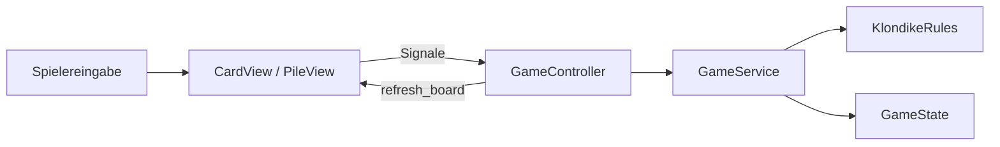
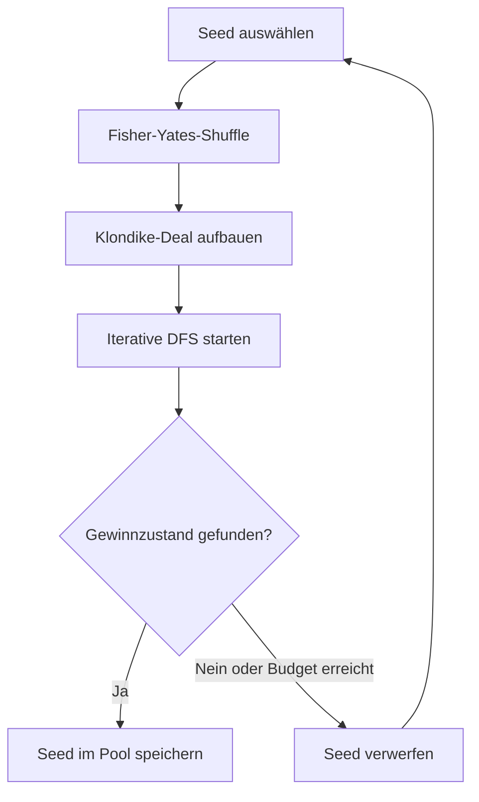

<div align="center">

# ♠ Klondike Solitaire

**Ein klassisches Solitaire-Spiel, entwickelt mit Godot 4.**

Ereignisgesteuerte Spiellogik, responsive Darstellung und animierte Karteneffekte.

</div>

---

## Über das Projekt

Dieses Projekt setzt klassisches Klondike Solitaire in Godot um. Spiellogik, Regeln und Darstellung sind voneinander getrennt, sodass neue Kartenstile, Effekte und Komfortfunktionen ergänzt werden können, ohne die Kernregeln anzufassen.

## Features

- Vollständiges Klondike-Spielfeld mit Stock, Waste, Tableau und Foundations
- Karten und gültige Tableau-Sequenzen per Drag-and-drop bewegen
- Automatische Zielauswahl beim Anklicken einer Karte
- Automatisches Aufdecken der nächsten Tableau-Karte
- Stock erneut aus dem Waste aufbauen
- Undo
- Spielstand speichern und laden
- Automatisches Beenden, sobald alle Karten aufgedeckt sind
- Responsive Board-Skalierung für unterschiedliche Fenstergrößen
- Gewinnanimation
- Modularer Kartenshader mit Outline- und Shine-Effekt

## Voraussetzungen

- [Godot Engine 4.6](https://godotengine.org/)
- Keine zusätzlichen Abhängigkeiten oder Plugins

## Projekt starten

1. Repository klonen oder herunterladen.
2. `project.godot` im Godot Project Manager importieren.
3. Das Projekt mit `F5` oder über **Run Project** starten.

Alternativ über die Kommandozeile:

```powershell
godot --path .
```

## Steuerung

| Aktion | Eingabe |
|---|---|
| Karte oder Sequenz bewegen | Anklicken oder ziehen |
| Zug rückgängig machen | `Ctrl` + `Z` |
| Spiel speichern | `Ctrl` + `S` |
| Spiel laden | `Ctrl` + `L` |
| Neues Spiel starten | `Ctrl` + `N` |
| Gewinnanimation testen | `W` in einem Debug-Build |

## Architektur

Das Spiel benötigt keinen eigenen permanenten Gameplay-Loop. Godot verarbeitet Eingaben und Signale; nur zeitabhängige Animationen werden pro Frame aktualisiert.



Die Verantwortlichkeiten sind klar aufgeteilt:

- **Views** verarbeiten Eingaben und stellen Karten sowie Stapel dar.
- **GameController** koordiniert Auswahl, Spielzüge, UI und Siegprüfung.
- **GameService** verändert den Zustand atomar und verwaltet Undo sowie Spielstände.
- **GameState** enthält Karten und Stapel ohne Abhängigkeit von der Oberfläche.
- **KlondikeRules** validiert Spielzüge unabhängig von der Darstellung.

## Lösbare Deals und Solver

Das Spiel teilt nicht einfach ein zufälliges Deck aus. Stattdessen erzeugt es reproduzierbare Kandidaten und akzeptiert nur Deals, für die der Solver tatsächlich einen vollständigen Gewinnpfad gefunden hat.

Der Ablauf kombiniert mehrere Algorithmen:

1. **Fisher-Yates-Shuffle:** Aus einem numerischen Seed wird eine gleichmäßig gemischte Reihenfolge der 52 Karten erzeugt. Derselbe Seed liefert immer dasselbe Deck.
2. **Rejection Sampling (Generate-and-Test):** Der Generator legt das Deck nach dem Klondike-Schema aus und lässt es prüfen. Ohne gefundenen Lösungsweg wird der Seed verworfen und der nächste Kandidat erzeugt.
3. **Iterative Depth-First Search (DFS):** Der `ThoughtfulSolver` untersucht mögliche Zugfolgen mithilfe eines expliziten LIFO-Stacks. Ein rekursiver Aufrufstapel wird dadurch vermieden.
4. **Graphsuche mit Transposition Table:** Bereits untersuchte Spielzustände werden über einen kanonischen Schlüssel gespeichert. Identische Zustände und Zyklen werden nicht erneut durchsucht.
5. **Begrenzte Suche:** Ein Node-Budget begrenzt Rechenzeit und Speicherverbrauch pro Kandidat.



Der Solver arbeitet als „Thoughtful Solitaire“-Solver mit Kenntnis aller Karten, auch der verdeckten. Ein Spiel gilt erst dann als gewonnen, wenn alle vier Foundations vollständig bis zum König aufgebaut wurden. Der gefundene Pfad ist daher ein konstruktiver Lösbarkeitsbeweis.

Für eine schnellere Suche gelten zwei bewusste Vereinfachungen:

- Karten werden nicht von einer Foundation zurück ins Tableau bewegt.
- Zwischen Tableau-Stapeln wird nur der maximal gültige, bereits aufgedeckte Lauf bewegt.

Außerdem ist die Suche durch das Node-Budget begrenzt. Deshalb kann ein tatsächlich lösbarer Deal abgelehnt werden, wenn seine Lösung nicht innerhalb des Budgets oder der vereinfachten Zugmenge gefunden wird. Das erzeugt keine falsch akzeptierten Deals: Gespeichert werden ausschließlich Seeds, für die ein kompletter Gewinnpfad gefunden wurde.

Die gefundenen Seeds werden in `user://solvable_seeds.json` zwischengespeichert. Ist der Pool leer oder die Datei noch nicht vorhanden, erzeugt ein Hintergrund-Thread neue Seeds; bis zum ersten verfügbaren Deal bleibt das Spielfeld hinter dem Ladebildschirm verborgen.

## Karteneffekte

Die Karten verwenden einen gemeinsamen CanvasItem-Shader. Effekte werden als getrennte Funktionen in einer festen Reihenfolge angewendet:

```text
Kartentextur → Shine → Outline → Premultiplied Alpha
```

Parameter wie Farbe, Stärke, Geschwindigkeit und Shine-Intervall können über das `ShaderMaterial` angepasst werden. Zusätzliche Effekte lassen sich in `shader/card_effects.gdshader` als weitere Module ergänzen.

## Tests

Die Tests laufen headless und prüfen unter anderem Tableau- und Foundation-Regeln, atomare Spielzüge, Undo, Stock-Recycling, Speichern/Laden und die Gewinnanimation.

```powershell
godot --headless --path . --script tests/test_runner.gd
```

Erwartete Ausgabe:

```text
All Solitaire tests passed.
```

## Projektstruktur

```text
res://
├── assets/
│   ├── backgrounds/    Hintergrundgrafiken
│   ├── cards/          Karten, Rückseite und Stapel-Platzhalter
│   └── sounds/         Musik und Soundeffekte
├── data/               Konfigurierbares Kartentheme
├── scenes/
│   ├── cards/          CardView und PileView
│   ├── main/           Hauptszene und Spielfeld
│   └── ui/             Buttons und Einstellungen
├── scripts/
│   ├── animation/      Gewinnanimation
│   ├── controllers/    Koordination des Spielablaufs
│   ├── model/          Spielzustand und Datenobjekte
│   ├── resources/      Benutzerdefinierte Resources
│   ├── rules/          Klondike-Regeln
│   ├── services/       Spielaktionen, Persistenz und Seed-Pool
│   ├── solitairesolver/ Deal-Generator, Karten-Codec und Klondike-Solver
│   └── views/          Darstellung und Eingabeverarbeitung
├── shader/             Modulare Karteneffekte
└── project.godot       Godot-Projektkonfiguration
```

---

<div align="center">

Gebaut mit ♣ ♦ ♥ ♠ und Godot.

</div>
